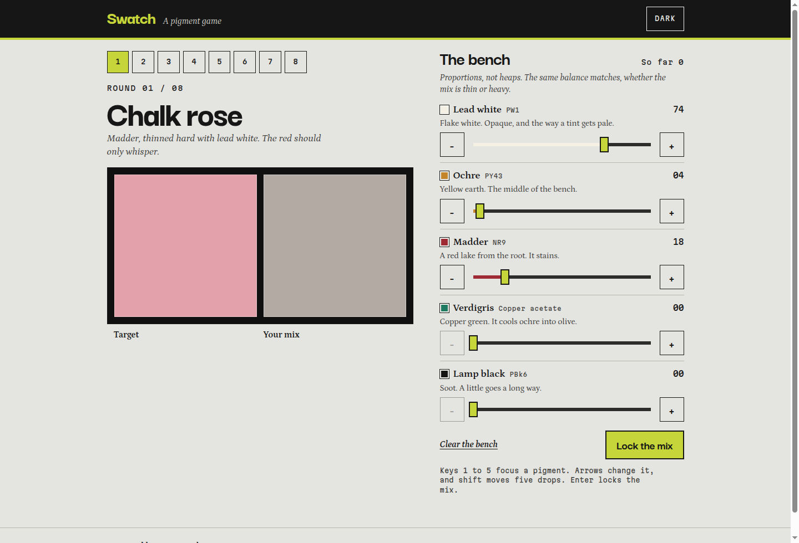
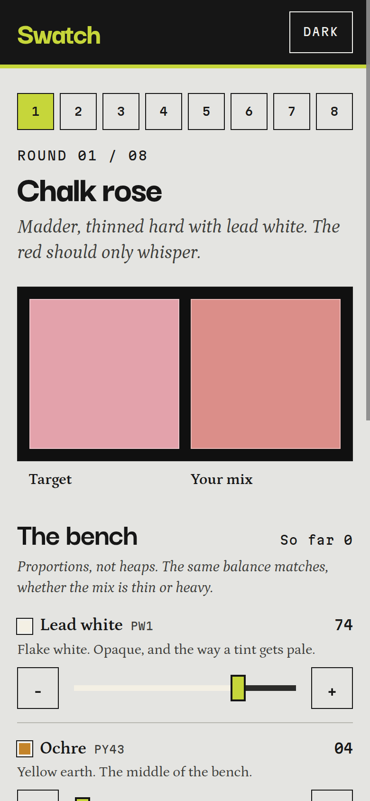
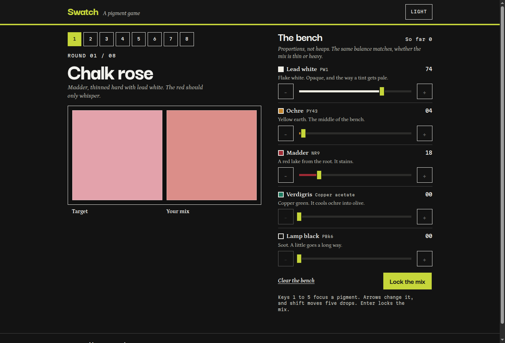

# Swatch

A small game about mixing paint. Eight target swatches. Five historical pigments. You balance them by eye, lock the mix, and the score is the perceptual distance between the two colours.

**Live:** https://niaz507.github.io/swatch-game/





Night, on the same zinc and lemon:



## The idea

Paint does not average. Madder and verdigris do not make a bright middle; they make a darker, muddier colour. Lead white pales a tint. Lamp black takes over if you let it. Swatch is that problem, eight times.

Each round shows a target that can be mixed from the pigments on the bench: lead white, ochre, madder, verdigris, and lamp black. Move the sliders until your swatch sits beside the target, then lock it. The two colours stay side by side. After eight rounds there is a proof: a score out of 1000, a rank, and a line you can copy. The best total is kept in the browser.

The mix is subtractive. Each pigment is a reflectance. Those are combined with a single-constant Kubelka–Munk model, the same arithmetic a simple opaque-paint mix uses, so complements darken instead of sliding toward grey. Only the balance matters. A thin mix and a heavy one of the same proportions come out the same colour, which is why the sliders are shares and not spoonfuls.

The score is CIEDE2000, computed in Lab from the sRGB of the two swatches. A perfect match is 125 for that round. Eight perfect rounds are 1000. The arithmetic lives in `colour.js`, with no DOM, so the page and the tests share it.

[Designed by Niazur Rahman](https://www.niazur.me)

## How to play

The target is on the left of the black tray. Your mix is on the right. It starts as the bare panel, which is not a pigment, so leaving every slider at zero cannot hit a colour.

| | |
| --- | --- |
| Slider | Set that pigment from 0 to 100 drops. |
| − / + | One drop. |
| 1 to 5 | Focus that pigment, from lead white down to lamp black. |
| Arrows | Change the focused pigment by one drop. Shift moves five. |
| Enter | Lock the mix. Enter again goes to the next colour. |
| Clear the bench | Return this round to the bare panel. |

Locking is final for that round. The note under the score says which way you missed: lighter, darker, redder, greener, yellower, bluer. Distance is CIEDE2000. Under about 2 the eye may argue.

| Distance | Points, out of 125 |
| --- | --- |
| 0 | 125 |
| 2 | 112 |
| 5 | 95 |
| 8 | 80 |
| 12 | 64 |
| 20 | 41 |
| 30 | 24 |

At the end, Copy puts the result on the clipboard, for example `Swatch 848/1000 · Palette hand`.

| Score | Rank |
| --- | --- |
| 920–1000 | Principal colourist |
| 780–919 | Palette hand |
| 600–779 | Studio mixer |
| 400–599 | Ground layer |
| Below 400 | Raw canvas |

Light and dark follow the system on the first visit. The choice is remembered. The best score is remembered too.

## Type and colour

This is not the green-and-Syne system of the studio site, and not the warm paper and madder of Kern. A mixing game should look like a counter: neutral ground, so the page does not tint the swatches, and one lemon for the things you touch.

The faces are a newspaper pairing turned around. A grotesque for the names, a text serif for the sentences, a monospace for the figures.

| Role | Face | Why |
| --- | --- | --- |
| Display | [Darker Grotesque](https://fonts.google.com/specimen/Darker+Grotesque) | Gabriel Lam and ViệtAnh Nguyễn. A slightly narrow grotesque with a high x-height. The colour names and the wordmark sit in the extra-bold. |
| Text | [Petrona](https://fonts.google.com/specimen/Petrona) | Ringo R. Seeber. A reading serif with a large x-height and real italics. The notes and the round descriptions are set in it, which keeps the page from becoming a wall of grotesque. |
| Figures | [Martian Mono](https://fonts.google.com/specimen/Martian+Mono) | Roman Shamin, Evil Martians. Wide, a little blunt, and already tabular. Round numbers, drop counts, and the share line. |

All three are free under the Open Font License and loaded from Google Fonts. Darker Grotesque is used at 600–800, Petrona at 400 and 600 with italics, Martian Mono at 400 and 500.

The palette is zinc, carbon, and lemon. Verdigris appears only as a pigment on the bench. It is a copper green, and it is not the colour of the interface. There is no blue, and no gradient.

| Token | Light | Dark | Use |
| --- | --- | --- | --- |
| Zinc | `#E4E4E1` | `#131313` | Page |
| Ink | `#161616` | `#F2F2EE` | Text, rules, the header band |
| Muted | `#3C3C39` | `#C6C6BE` | Notes, the round description |
| Lemon | `#C6D63A` | `#C6D63A` | Wordmark, the lock-in button, the current round, slider thumbs |
| Header quiet | `#D0D0C8` | `#D0D0C8` | “A pigment game”, on the carbon band |
| Mount | `#101010` | `#101010` | The tray behind both swatches, so the surround does not change between themes |

Ink on zinc is about 14.2:1. Muted on zinc is about 8.7:1, and muted on the night ground is about 10.8:1, so the italic notes clear small text. Black on lemon is about 11.3:1, and lemon on the carbon header is the same, so the wordmark and the button are both fine at small sizes. Focus is a 2px ring, 3px outside the control: ink on the page, lemon on the header, where ink would disappear. `prefers-reduced-motion` collapses the short colour transition. The swatches keep their real paint in forced-colours mode, because a mixing game with system colours instead of pigments cannot be played.

## Run it

`index.html` is at the repository root. Open that file, or serve the folder. There is no build step, which is what GitHub Pages needs:

```bash
python3 -m http.server
```

The live link above works once GitHub Pages is set to deploy from the `main` branch, root directory.

## Tests

```bash
node test/colour.test.js
```

`npm test` runs the same script. It covers the Kubelka–Munk mix (white lightens, black darkens, complements get darker than their average, ratios are what matter), the CIEDE2000 sample pair, the score curve, the ranks, and that the eight targets are far enough apart to tell by eye.

## License

[MIT](LICENSE). Copyright 2026 Niazur Rahman.
